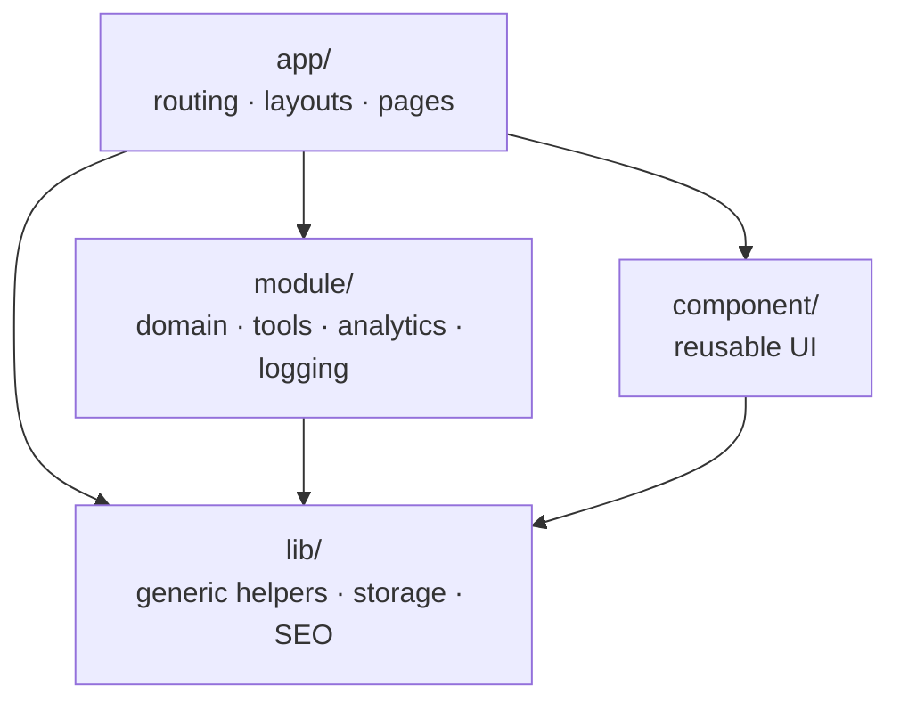
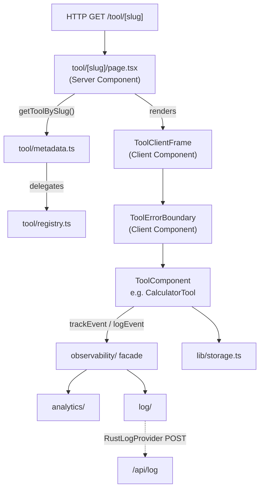

# ARCHITECTURE

## Planned v0.4.4 quality and task-guide extension

Status: planned on 2026-10-26; no source implementation is claimed here.
The [v0.4.4 implementation plan](plans/v0.4.4-implementation-plan.md) is the
exact behavior/path contract. The [quality audit](reports/ADSENSE_QUALITY_AUDIT_2026-10-26.md)
records the inspected baseline and distinguishes source from live observations.

Existing registry, category, metadata, route, processing, storage, telemetry
and advertisement owners remain authoritative. Correct titles in lib/seo,
arithmetic in the existing math/everyday/time owners, and caching in public/sw.js.
No new tool registry, calculation framework or processing engine is introduced.

The bounded new node is src/module/content/taskGuide.ts, containing exactly
four authored multi-tool task guides. It refers to existing ToolIds and example
records without duplicating tool names, categories or canonical paths. The
guide hub and detail Server Components live at src/app/guide/page.tsx and
src/app/guide/[slug]/page.tsx. They resolve references through current metadata/
example owners, call the generic SEO helper, and pass display-ready props to
the presentation-only src/component/content/TaskGuidePage.tsx. Unknown guide
slugs return notFound. No CMS, MDX evaluator, server content API or new store
is added. Generic lib/seo never imports module/content.

The existing homepage composes a compact guide section server-side between
its featured tasks and HomeClient. Tool routes pass resolved taskGuideLink
items into ToolPageTemplate; category routes compose relevant guide links.
Guide prose never enters client catalog payloads. Navigation adds Guides after
All tools and retains About last; fixed-header/document-flow-footer ownership
and approved About copy are unchanged.

The existing valueExamples/ToolExamplePanel path expands from five to nine
file demonstrations using a separate immutable public/examples/v0.4.4/
manifest and exact assets named in the plan. A featuredOnHome field and
getFeaturedValueExample() keep the existing five homepage tasks stable.
The HEIC sample retains its upstream MIT provenance; original measurements
do not imply original ownership of that input.

The five guide URLs are planned additions to the existing 30-route sitemap,
yielding 35 route identities after implementation. All guide pages remain
outside AdSenseEligiblePage. The server advertising policy will explicitly
deny non-production Vercel environments; client code cannot grant eligibility.
The service worker retains one owner with explicit same-origin cache classes
and network-only exclusions for APIs, private/query data and RSC/prefetch.

All details, required tests and report paths belong to the implementation plan.
After source validation, update the corresponding module/component specs and
current status; retain older architecture sections as date-scoped history
where the new implementation changes them.

## Diagnostic hotfix architecture

Diagnostics preserve bounded redacted Error fields, causes, aggregate children,
React component stacks and explicit runtime context. The observability module
owns the shared serializer/redactor and server diagnostic sink. Browser logs
enter through `/api/log`; Next server failures enter through `onRequestError`.
Both emit structured severity logs independently of optional Neon persistence
in `observability.error_diagnostic`. Deployment context is appended server-side.
Metrics remain separate in the existing event and daily aggregate tables.
Detailed diagnostics expire after 30 days; metric retention remains unchanged.
The private dashboard reads latest-25 diagnostics using its SELECT-only role.
No arbitrary metadata, request headers/bodies, environment dumps or user input
are captured. Additive migrations run explicitly before deployment.

Both Next configurations explicitly bound Turbopack to their own project
directory. This prevents a nested dashboard build from discovering public
instrumentation through an inferred parent lockfile root. Public standalone
file tracing uses the same isolated project root, including contained worktrees.

## Persistent observability and separate dashboard

The public application remains public at the repository root. Its existing
observability facade/providers own browser telemetry. `/api/log` remains the
sanitized technical diagnostic path; `/api/metric` alone persists allowlisted
measurement events, including explicit `client-error` metrics, into Neon Postgres.
Metric tables store no diagnostic text or client timestamps. Dedicated error_diagnostic records preserve bounded redacted diagnostic text and reporter timestamps.
Server receipt time defines UTC aggregation and retention boundaries.

`database/observability` owns the dedicated SQL schema and transactional daily
maintenance. Raw events retain 90 days, with deletion permitted only for a
successfully rolled-up UTC day. Daily event/vital history retains indefinitely.
The operational maintenance route uses CRON_SECRET, not application users or
sessions. Daily cron belongs to the public Vercel project.

`dashboard/` is an independently installable Next.js application deployed as a
second Vercel project. It reads the same database with a SELECT-only production
role. All SQL stays server-side; no dashboard code enters public navigation,
registry, sitemap, service worker or public build. Vercel Authentication with
All Deployments protects only the dashboard project; there is no app auth.

The metric contract adds optional coarse viewport class (width only) and an
explicit error category/tool ID projection. Metric error identity deduplication
is independent of diagnostic-log identity deduplication, preserving both sinks.
See `OBSERVABILITY.md` and `../dashboard/DEPLOYMENT.md`.

### v0.3.1 Vercel Web Analytics boundary

v0.3.1 introduces Vercel Web Analytics as a separate platform-level traffic measurement surface,
not another owner of application-domain telemetry. Automatic page views belong
to the Vercel integration; canonical tool events, Web Vitals, errors and
diagnostics remain owned by the existing application observability contracts.

The implemented code boundary is deliberately small:

- `src/module/analytics/vercelWebAnalytics.client.ts` owns enablement and the
  pure URL/event redaction helper;
- `src/component/observability/VercelWebAnalytics.tsx` owns the framework
  wrapper around `@vercel/analytics/next`;
- `src/app/layout.tsx` composes that wrapper and contains no provider-specific
  event logic.

Equivalent file names may be adjusted during implementation if current
repository retrieval shows an established owner that is more appropriate, but
ownership must remain one-way: tools and domain modules do not import Vercel's
provider package directly.

The first delivery emits no custom Vercel events. A future custom-event
integration must implement/extend the existing analytics-provider abstraction
and canonical safe-event allowlist rather than introduce parallel event names or
duplicate tool telemetry. The integration must also preserve default-off
container/test behavior and must not add Vercel Analytics to the independent
protected dashboard project without separate authorization.

This document defines the architectural boundaries of the project.
Any generated code MUST follow this structure.

## Anonymous user reporting (v0.4.2 Batch 1)

Status: implemented and included in the v0.4.2 GitHub Release. Production deployment and activation are verified separately. The public entry is gated by the build-time flag
`NEXT_PUBLIC_SUPPORT_ENABLED=true` (default off) and needs the external provisioning listed in [Deployment](DEPLOYMENT.md).

Support is a domain independent of observability. Report text and contact details never enter `/api/log`, `/api/metric`, Vercel
Web Analytics, the analytics/logging facades, advertising, browser storage or service-worker caches. `/api/metric` remains the only
route that writes the observability database; `/api/support/report` writes only the separate `support` schema.

Public write path: `RootLayout` (Server Component) builds a serializable `{ id, slug, name }` projection of the registry and passes
the client `SupportCoordinator` through `AppShell.footerActionSlot` to `Footer.action`. AppShell and Footer receive only a `ReactNode`
and know nothing about tools, routes or reporting. The coordinator (`src/module/support/`) reads the pathname with `usePathname`,
derives the default tool from the projection (Site-wide for general or unknown routes, never an invented tool), owns submission
state, and renders the presentational `SupportDialog` (`src/component/support/`) in a portal using a native modal `<dialog>`.
`POST /api/support/report` is a thin adapter over `submission.server.ts`, which checks origin, reads at most 16 KiB, validates the
exact versioned contract with the registry (tool id and allowlisted pathname are re-validated on the server), verifies the Turnstile
token, then calls `persistence.server.ts`, which invokes the single atomic `support.submit_report()` function.

Private delivery path: `GET|POST /api/support/deliver` (Bearer `CRON_SECRET`, timing-safe) -> `delivery.server.ts` -> lease-based
outbox -> `github.server.ts` (private issue, reconcile-before-create) and `resend.server.ts` (operator email and optional consented
receipt). Provider calls never run inside a database transaction and a provider failure never removes an accepted report.

Site chrome (current): `AppShell` (a Server Component) wraps the single server-rendered header in the client
`HeaderViewportControl` (in `src/component/layout/`), which keeps the header fixed to the top of the viewport and sizes one in-flow
footprint to its measured height. The single `Footer` is plain document-flow content after the main region. The retractable header,
the fixed footer, `FooterViewportControl` and its preference helper were removed; the footer advertising slot stays in normal
flow. Neither layout component knows tools, routes or reporting; details are in [DESIGN.md](DESIGN.md).

Protected read path: the existing independent `dashboard/` adds `/support` and `/support/[id]` using `SUPPORT_DASHBOARD_DATABASE_URL`
(SELECT-only on three views). It adds no route handlers or write privileges, and the observability pages keep their own credential.

| Concern | Owner |
| --- | --- |
| Request/receipt contract, taxonomy, validation, context | `src/module/support/{contract,taxonomy,validation,context}.ts` (isomorphic, pure) |
| Tool identity | `src/module/tool/registry.ts` only; `projection.ts` exposes `id`, `slug`, `name` |
| Client state | `SupportCoordinator.tsx`, `submission.client.ts`, `TurnstileChallenge.tsx` |
| Dialog presentation | `src/component/support/SupportDialog.tsx` |
| Server intake | `submission.server.ts`, `persistence.server.ts`, `turnstile.server.ts`, `neon.server.ts` |
| Delivery | `delivery.server.ts`, `github.server.ts`, `resend.server.ts`, `provider.server.ts` |
| Storage | `database/support/` (owner, roles, README) |
| Dashboard | `dashboard/src/{lib/support*.ts,component/SupportView.tsx,app/support}` |

`neon.server.ts` is the only constructor of support connections. A loopback-only `SUPPORT_DATABASE_HTTP_ENDPOINT` override exists
so a disposable local database can stand behind the Neon HTTP driver in tests; any non-loopback value is ignored.

## Deployment Runtime Boundary

Production packaging follows `Next.js standalone server → Docker runtime →
public/static assets → browser`. Containerization changes deployment packaging,
not application domain architecture. The generated standalone server serves the
same-origin Worker, decoder, service-worker, manifest, and license assets. See
`docs/DEPLOYMENT.md` for the runtime guide.

## Core Goal

The document family is implemented under `src/module/tool/document/`, with
five explicit registry entries and the existing server tool-route composition.
PdfFile owns source primitives, limits and bounded errors; pageSelection and
orderedFile own pure transitions. Tool components retain operation state,
focus, cancellation, generations, result URLs and identity-only telemetry.

`pdfRuntime.client.ts` imports PDF.js 6.4.299 at operation time for inspection,
rendering and independent output verification. Same-origin assets under
`public/vendor/pdfjs/6.4.299/` contain the native worker and 14 standard fonts;
no CMaps, image WASM or QuickJS assets are shipped. Only `pdfLib.worker.ts`
imports pdf-lib 1.17.1 in production source, for Merge, Split and Images to PDF.
PDF to JPG / PNG uses PDF.js and native canvas encoding/bitmap verification.
Compress PDF composes a distinct short-lived `qpdf.worker.ts` with the pinned
project-owned QPDF 12.4.2 JS/WASM in `public/vendor/qpdf/12.4.2/`, then compares
bytes and independently verifies smaller candidates through PDF.js. It offers
LOSSLESS_STRUCTURAL only; no reduction is a normal outcome.

No document bytes are uploaded or processed by a server. Ordinary assets and
separately enabled safe observability may use the network. Runtimes activate
only for operations and cache on demand through the existing service worker;
they are not shell precache assets. Warmed offline operations have inherited
Batch 6 browser evidence, without promising cold offline availability. Normal
builds consume committed vendor assets; controlled QPDF rebuilds belong to
`script/qpdf/`. The standalone container serves the same assets and notices.
See [PdfFile](modules/PdfFile.md), [PdfProcessing](modules/PdfProcessing.md)
and the five operation specs. There is no universal PDF framework.

Image Resizer, Image Compressor and Image Converter share narrow source-file rules and browser
inspection in `module/tool/image/imageFile.ts` and `imageFile.client.ts` (see
`modules/ImageFile.md`). Their identical source presentation is owned by the
presentation-only `component/tool/image/ImageSourcePanel.tsx`, which receives
display-ready props and imports no module-domain behavior (see
`modules/ImageSourcePanel.md`). All keep operation encoders, React state,
controls/results, object URL ownership and execution telemetry local.
This adds no route, server or generic
processing framework owner.

HEIC Converter introduces a dedicated image worker boundary (see
`modules/HeicConverter.md`). Only `heicConverter.worker.ts` imports
`heic-to/next` from pinned `heic-to@1.5.2`. The wrapper creates a worker lazily
after a selected file passes non-empty/25 MiB prechecks; the decoder is not
part of normal route execution or initial HEIC rendering. Each inspect or
convert operation owns a short-lived worker, terminated on terminal response,
cancellation, replacement, Reset or unmount. Main-thread UI receives only
bounded inspection/result messages and Blobs. HEIC source UI remains local;
the existing shared image owners are not expanded. Production release is
subject to explicit human/legal decoder-license approval.

Build a scalable, full-stack utility platform using Next.js App Router,
with strict separation between:
- routing/composition
- business logic
- UI primitives
- tool implementations

The architecture must remain boring, explicit, and predictable.

---

## High-level Structure

```
src/
  app/          -> routing, layouts, pages (composition only)
  module/       -> domain logic, tools, registries, analytics, logging, observability
  component/    -> reusable UI (no domain logic)
  lib/          -> shared utilities (non-UI)
```

---

## Architecture Diagrams

### Layer dependencies

Arrows show allowed import direction. `lib/` has no project-level imports.



### Tool page rendering pipeline

From HTTP request to rendered tool, showing the server/client split and
observability path.



---

## Responsibilities by layer

### app/
- Defines routes and layouts
- Selects which components/modules to render
- Does NOT implement business logic
- Does NOT contain tool logic
- Server Components by default

**Routes:**
- `/` — Home page (`page.tsx`, `HomeClient.tsx`)
- `/discover` — Tool discovery page with category grouping and search
  (`discover/page.tsx`, `discover/DiscoverClient.tsx`)
- `/about` — Approved About copy (`about/page.tsx`)
- `/contact` — General contact page with the `ContactForm` client component (`contact/page.tsx`)
- `/tool/[slug]` — Individual tool page (`tool/[slug]/page.tsx`)
- `/category/[category]` — Category listing page (`category/[category]/page.tsx`)
- `/api/contact` — General contact intake and direct Resend delivery (`api/contact/route.ts`; owner `module/contact/`); independent of `/api/support/*`
- `/api/health` — Health check endpoint (`api/health/route.ts`)
- `/api/log` — Sanitized technical diagnostics (`api/log/route.ts`)
- `/api/metric` — Bounded measurement ingestion (`api/metric/route.ts`)
- `/api/observability/maintenance` — Cron-protected rollup/retention (`api/observability/maintenance/route.ts`)

**Supporting files:**
- `navData.ts` — Navigation item definitions
- `global.css` — CSS custom properties for theming

### module/
- Owns all domain concepts (tools, registry, capabilities, analytics, logging,
  observability)
- Tool implementations live here
- Analytics abstraction lives here
- Logging module lives here
- Observability facade lives here
- UI allowed ONLY inside tool components
- No routing logic allowed

### component/
- Pure UI components
- No knowledge of tools, slugs, or routing
- No side effects unless explicitly client-only

**Subgroups:**
- `common/` — Generic reusable components (Button, Input, StatusPanel,
  ToolSearch, ThemeToggle)
- `layout/` — App shell, header, footer, navigation and optional ad slots,
  layout types, ServiceWorkerRegister
- `tool/` — Tool-specific presentation components (ToolPageTemplate,
  ToolClientFrame, ToolSection, ToolErrorBoundary)

### lib/
- Generic helpers (SEO helpers, formatting utilities, storage abstraction)
- No React components
- No imports from module/ layer

---

## Server vs Client rule

- Pages (`app/**/page.tsx`) are Server Components
- Tool UI components are Client Components
- Do NOT mark layouts or pages as `"use client"`

---

## Tool system

Tools are the core domain concept. Each tool is a React component registered
in `src/module/tool/registry.ts` via the `tool_definition_list` array.

### Category definitions (`src/module/tool/category.ts`)
- Single runtime owner of canonical category identity: ids, canonical order,
  page title, page description, and validation (`isToolCategory`, definition
  lookup). Static `as const` list; no reflection or dynamic registration.
- `ToolCategory` is derived from this list and re-exported by
  `src/module/tool/type.ts`; there is no second hand-maintained union.
- Canonical order: `document, text, math, converter, time, image, developer`.
- The registry remains the authority for registered tools and therefore for
  which categories are populated. `getAvailableCategory()` (metadata.ts)
  returns the populated categories in canonical order.
- The category route (`app/category/[category]/page.tsx`) validates and
  describes categories through this module; it keeps no category list or
  title/description switch of its own. Nav, home chips and breadcrumbs use
  `getToolCategoryLabel` from the category owner, including Converters.
- The post-release migration keeps Length/Weight in converter and moves QR to
  developer without changing tool URLs. The route permanently redirects the
  historical /category/everyday URL to /category/converter.
- Category color identity is theme tokens in `src/style/theme.css`
  (`[data-category]`); see DESIGN.md.

### Registry (`src/module/tool/registry.ts`)
- Single source of truth for all tool definitions
- Provides low-level queries: `getToolBySlug()`, `getToolByCategory()`
- All tools are explicitly imported and registered

### Metadata index (`src/module/tool/metadata.ts`)
- Higher-level query layer wrapping the registry
- Provides: `getAllTool()`, `getToolSeoBySlug()`, `getAllToolSeo()`,
  `getAvailableCategory()`, `getToolCount()`, `getAllTag()`, `getToolByTag()`,
  `getToolByPopularity()`
- Does NOT duplicate registry data — delegates to `tool_definition_list`
- New query functions go here, not in registry
- `getToolBySlug()` / `getToolByCategory()` remain registry-level exports (see
  above) and are not re-exported from `metadata.ts`

### Current tools

The current registry contains 18 tools across seven populated categories in
canonical order document, text, math, converter, time, image, developer; the
released v0.4.2 sitemap derives 28 URLs, including `/privacy`. The tagged v0.4.0
release had 27 URLs before the privacy route and before the post-release
category migration. The v0.3.1 launch catalog historically had 15 tools, six
populated categories and 23 URLs. Production deploys `master` continuously;
deployment identity is separate from source and release identity.

Current v0.4.2 source retains all 18 tools and seven populated categories,
replaces `everyday` with `converter` (Converters), and moves QR to `developer`.
The v0.4.2 sitemap included `/privacy` and had 28 canonical URLs. v0.4.3 Batch 4 adds
`/about` and `/contact`, so the source now derives 30 (5 static routes, 18 tools,
7 categories). The preceding v0.4.0 statement remains the historical release record.

v0.4.3 Batch 4 adds `module/content` (typed publisher copy) and `module/contact`
(validation, bounded body, origin check, direct Resend sender). Contact messages are
visitor-authored email content and never enter observability or the support database.

- **Merge PDF** (`document/MergePdfTool.tsx`) — ordered PDF assembly
- **Split PDF** (`document/SplitPdfTool.tsx`) — ordered page-group outputs
- **Images to PDF** (`document/ImagesToPdfTool.tsx`) — JPEG/PNG page assembly
- **PDF to JPG / PNG** (`document/PdfToImageTool.tsx`) — selected-page export
- **Compress PDF** (`document/CompressPdfTool.tsx`) — lossless structural mode
- **Image Resizer** (`image/ImageResizerTool.tsx`) — local dimension changes
- **Image Compressor** (`image/ImageCompressorTool.tsx`) — truthful byte reduction
- **JPG / PNG / WebP Converter** (`image/ImageConverterTool.tsx`) — local encoding
- **HEIC → JPG / PNG Converter** (`image/HeicConverterTool.tsx`) — isolated decoder
- **JSON Formatter / Validator** (`developer/JsonFormatterTool.tsx`) — strict,
  token-preserving local JSON format/minify/validate (`developer/jsonFormat.ts`
  holds the pure iterative scanner/emitter)
- **Word / Character Counter** (`text/WordCharacterCounterTool.tsx`) — live
  Unicode word, grapheme-cluster character, non-whitespace and line counts
  (`text/textMetric.ts` holds the pure measurement rules; no per-keystroke
  telemetry)
- **QR Code Generator** (`everyday/QrCodeGeneratorTool.tsx`, current category
  `developer`) — local QR
  generation to a fixed 512 × 512 PNG (`everyday/qrCode.ts` holds the pure
  payload validation, ECC-M matrix generation and RGBA raster; the component owns
  the canvas, PNG Blob and object-URL lifecycle)
- **Slugify Text** (`text/SlugifyTool.tsx`) — Convert text into URL-safe slugs
- **HTML Text Extractor** (`text/HtmlTextExtractorTool.tsx`) — Extract visible
  text from HTML with preserved line breaks
- **Calculator** (`math/CalculatorTool.tsx`) — Evaluate simple math expressions
- **Length Converter** (`everyday/LengthConverterTool.tsx`) — Convert between
  common length units
- **Weight Converter** (`everyday/WeightConverterTool.tsx`) — Convert between
  common weight units
- **Time Arithmetic** (`time/TimeArithmeticTool.tsx`) — Add and subtract
  HH:MM time values with carry/borrow normalization (`time/timeArithmetic.ts`
  holds the pure `calculateTime`/`addTime`/`subtractTime` logic)

QR dependency boundary: `qrCode.ts` is the only production importer of the
exact-pinned encoder `uqr` (0.1.3, no dependencies); the test-only decoder `jsqr`
(1.4.0, devDependency) is never imported by production source. Pure owners hold
no React, storage, telemetry or network access.

### Recently used tool tracking (`src/module/tool/recentlyUsed.ts`)
- `getRecentTool()` — Returns list of recently used tool slugs
- `recordRecentTool(slug)` — Adds a slug to front of list, deduplicates, caps at
  10
- `clearRecentTool()` — Clears the list
- Uses `storage` abstraction, SSR-safe
- Does not modify tool components — consumer must call `recordRecentTool`
  explicitly

---

## Analytics abstraction (`src/module/analytics/`)

Platform-level analytics with swappable provider.

### Structure
- `type.ts` — event names, event prop interfaces, provider interface
- `provider.ts` — local lightweight provider (console + localStorage counter)
- `index.ts` — public API: `track()`, `identify()`, `enableAnalytic()`,
  `disableAnalytic()`, `setAnalyticProvider()`

### Rules
- Tools call only `trackEvent()` from `@/module/observability`
- No direct SDK usage inside tool components
- Provider can be swapped at startup via `setAnalyticProvider()`
- Events: `tool_opened`, `tool_executed`, `tool_result_copied`,
  `tool_mode_changed`

---

## Logging module (`src/module/log/`)

Internal system visibility with swappable providers.

### Structure
- `types.ts` — `LogLevel` (`debug`, `info`, `warn`, `error`), `LogMeta`
- `provider.ts` — `LogProvider` interface
- `logger.ts` — `ConsoleProvider` (default), `log` object (`log.debug`,
  `log.info`, `log.warn`, `log.error`), `setLogProvider()`, `setLogLevel()`
- `RustLogProvider.ts` — Provider that sends logs to `/api/log` via fetch
  (non-blocking, fail-silent)

### Rules
- Level filtering via `setLogLevel()`
- Providers are swappable via `setLogProvider()`
- All logging is non-blocking and SSR-safe
- `ConsoleProvider` never throws

---

## Observability Layer (`src/module/observability/`)

Combined facade unifying analytics and logging.

### API
- `trackEvent(event, prop)` — Product metrics (delegates to analytics `track()`)
- `logEvent(message, meta?)` — System debugging (delegates to `log.info()`)
- `captureError(error, meta?, trackAsEvent?)` — Logs error and optionally tracks
  an analytics event

### Principles
1. **Separation of Concerns**: Logging (technical) and Analytics (product)
   remain separate layers but are unified in the observability facade.
2. **Layering**:
   - `trackEvent()`: Product metrics.
   - `logEvent()`: System debugging.
   - `captureError()`: Automatic logging + optional analytics emission.
3. **Provider-Swappable**: Both logging and analytics support swappable
   providers.
4. **Non-Blocking**: Observability operations must never throw or block the UI
   thread.

---

## Error Handling Policy

### Tool Error Boundary (`src/component/tool/ToolErrorBoundary.tsx`)
- All tools are wrapped in a global error boundary inside `ToolClientFrame`.
- Catches runtime errors in tool components.
- Calls `captureError()` automatically with toolId and component stack.
- Displays a user-friendly fallback UI with a "Try again" option.

### Rules
- No direct `console.log` usage; use `log.info/warn/error` or `logEvent`.
- No direct analytics SDK calls; use `trackEvent`.
- Always use `captureError` in catch blocks at architectural boundaries.

---

## Log ingestion endpoint (`src/app/api/log/route.ts`)

Server-side endpoint for client log events sent by `RustLogProvider`.

### Behavior
- Accepts bounded POST JSON: `{ level, message, timestamp, meta, pathname }`, with fixed message categories and allowlisted metadata; rejects arbitrary fields and full URLs.
- Validates body shape and log level (`debug`, `info`, `warn`, `error`)
- Writes to server `console.log` as a safe sink
- Returns 204 on success, 400 on invalid input
- Fails safely — never exposes secrets or blocks

---

## Theme module (`src/module/theme/`)

### Palette and mode extension

The existing registry also owns six documented palette identities plus the
retained One Dark legacy choice. `themeStorage.ts` stores palette separately
through the same storage adapter; the existing `theme` key stays compatible.
ThemeProvider is the single interactive appearance state owner. ThemeToggle
consumes its palette/mode state and renders native radio groups. Runtime helpers
apply effective mode and palette attributes without owning a second store.
The existing inline pre-paint initializer is composed from the theme runtime
module by the server layout. Its bounded JSON storage reads are the pre-hydration
exception already used by the app; ordinary persistence uses `lib/storage` only.
System resolves to explicit light/dark attributes and tracks OS changes.
Legacy One Dark keeps its fixed dark CSS hook. See DESIGN.md for mappings and
the superseded four-choice baseline below.

### Historical four-choice baseline (superseded by the extension above)

The prior theme system was a multi-theme registry, not a binary light/dark
switch. Its four choices were `system`, `light`, `dark`, and fixed-dark
`onedark`. The current registry has six selectable palettes, each supporting
Light, Dark and System modes, while retaining fixed-dark One Dark.
`docs/DESIGN.md` is the canonical visual authority and documents the current
registry and runtime ownership.

### Structure
- `themeRegistry.ts` — declares `ThemeId`, the `theme_definition_list`
  (id/label/description per theme), `listThemes()`, and the `isThemeId()` type
  guard
- `themeStorage.ts` — `storeTheme(themeId)` / `loadTheme()`, persists the
  chosen `ThemeId` under the `"theme"` storage key via the `storage` adapter
- `themeRuntime.client.ts` — `setTheme(themeId)` / `getThemeFromDom()`, applies
  the theme by setting (or removing, for `"system"`) the `data-theme`
  attribute on `document.documentElement`; browser-context only

### Components
- `ThemeToggle` (`src/component/common/ThemeToggle.tsx`) — Client component in
  Header; lets the user pick from the registered theme list
- `ThemeProvider` (`src/component/common/ThemeProvider.tsx`) — Client
  component that applies the persisted/system theme on mount
- Inline script in `layout.tsx` reads `localStorage("theme")` before paint to
  prevent FOUC
- `suppressHydrationWarning` on `<html>` prevents hydration mismatch

### Behavior
- Reads user preference from `storage` via `themeStorage.loadTheme()`
- Falls back to system preference (`"system"` → no `data-theme` attribute;
  CSS `prefers-color-scheme` rule applies) via `matchMedia`
- Persists choice via `themeStorage.storeTheme(themeId)`
- Sets `data-theme` attribute on `<html>` via `themeRuntime.client.ts` to
  switch CSS variable tokens in `src/style/theme.css`

---

## Sitewide navigation and Home composition (Prompt 2 of 9, CURRENT on the local candidate)

- `src/app/navData.ts` owns the five primary `NavItem` definitions. `src/app/layout.tsx` derives the separate category `NavItem[]` from `getAvailableCategory()` and `getToolCategoryLabel` (now the canonical definition title) and passes both arrays to `AppShell` (`navItem`, optional `categoryNavItem`) and on to `Header`.
- `VerticalNav` (client) keeps the nav landmark and gains optional `categoryItem`: the desktop Categories disclosure and the mobile Menu overlay are component-local state; no second routing mechanism. `HeaderSearch` (new, client, `src/component/layout/`) is the generic Search utility targeting the existing `#tool-search` input. `ToolSearch` only gains the hash-triggered focus handoff.
- `src/component/common/UtilityCard.tsx` (new) is a presentation-only whole-card Link taking `href`, `title`, `description`, `categoryId` and `categoryTitle`; it imports no registry, category or workflow module. `HomeClient` maps registry data into it.
- `src/app/workflows/page.tsx` is a Server Component that lists the registry's four workflows as operational links (Prompt 6 made all four operational); a coming-soon section renders only for a non-operational registry entry. It processes nothing; see "Workflow runtime (Prompt 5)".
- `sitemap.ts` and `script/publicRouteInventory.ts` add the /workflows hub together (36 URLs) and the operational workflow detail URLs: one with Prompt 5 (37 URLs) and four with Prompt 6 (40 URLs). `sitemap.ts` is registry-driven; the inventory keeps its own independent literal list.

## Navigation wiring

- `NavItem` type in `src/component/layout/type.ts` includes optional `href`
- `navData.ts` defines items with real route hrefs: Home (`/`), Discover
  (`/discover`)
- (Superseded by the Prompt 2 section above for the header: five primary items plus a separate category list.)
- `VerticalNav` is a Client Component that renders `Link` from `next/link` for
  items with `href`
- Active state determined by `usePathname()` match against `href`
- Items without `href` or with `disabled` render as non-interactive spans

---

## Service worker (`public/sw.js`)

Minimal offline caching for PWA support.

### Strategy
- **Install**: Precaches `/` and `/discover`
- **Navigation requests**: Network first, cache fallback (stale-while-offline)
- **Static assets**: Cache first, network fallback
- **Turbopack worker bootstrap**: Reconstruct cached responses without the
  stored response URL. Different entries share its pathname and use fragment
  parameters, which Cache API keys cannot distinguish. The worker retains its
  constructor URL/fragment while the bootstrap remains available offline.
  Runtime assets cache on demand; no PDF asset is precached.
- **API routes**: Network only (no caching)
- **Activation**: Cleans old caches, claims all clients

### Registration
- `ServiceWorkerRegister` (`src/component/layout/ServiceWorkerRegister.tsx`) —
  Client component
- Registers `/sw.js` on mount, fails silently
- Included in root `layout.tsx`

---

## Persistent state layer (`src/lib/storage.ts`)

Unified persistence abstraction.

### API
- `storage.get<T>(key)` — read and parse JSON
- `storage.set<T>(key, value)` — serialize and write
- `storage.remove(key)` — delete

### Rules
- Backed by localStorage (current implementation)
- SSR-safe: all operations return null / no-op when `window` is undefined
- JSON serialization handled internally
- Designed for future backend swap (cookies, server storage, Rust backend)
- Used by: theme persistence, analytics counter, recently used tools

---

## SEO automation (`src/lib/seo.ts`)

Dynamic metadata generation from tool definitions.

### Functions
- `buildToolMetadata(seo)` — generates Next.js `Metadata` from tool SEO data
- `buildCategoryMetadata(slug, title, description)` — generates metadata for
  category pages

### Rules
- No hardcoded SEO in page files
- Tool pages export `generateMetadata` that calls `buildToolMetadata`
- Category pages export `generateMetadata` that calls `buildCategoryMetadata`
- Scales automatically when new tools are added to registry

---


---

## Test infrastructure

### Framework
- Vitest with Node environment
- Tests follow `*.test.ts` and `*.test.tsx` conventions alongside source files

### Unique test report
- Every test run generates a unique report directory under
  `test-report/<RUN_ID>/`
- RUN_ID is a timestamp + random hex suffix (e.g.,
  `2026-02-14T16-14-23-519Z-980e0fe0`)
- Each report contains `results.json` (JSON) and `results.xml` (JUnit)
- CI uploads `test-report/` as an artifact

### Local validation (`script/verify.ts`)
- Aggregate local validation runner exposed as `npm run verify`
- Runs typecheck, lint, test, and build in order with log capture under a
  shared RUN_ID
- Passes `VITEST_RUN_ID` to vitest so JSON and JUnit reports share the run
  directory
- Contains no governance context, prompt, or coding-agent invocation

### Browser validation foundation
- Document/PDF Batch 1 boundaries and the temporary test-only runtime harness
  are specified in [PdfFile](modules/PdfFile.md) and
  [PdfProcessing](modules/PdfProcessing.md). All five public document tools are
  registered; operation-specific unit/component and real-file browser tests
  complement the foundation harness and document-family integration tests.
- Playwright is a separate production-browser validation subsystem in
  `playwright.config.ts` and `test/e2e/`; it is not part of `script/verify.ts`.
- `npm run build` precedes `npm run test:e2e`. Playwright owns a fresh production
  server at `http://127.0.0.1:3100` and never reuses an existing server.
- Desktop and mobile Chromium contexts protect existing routes, shell,
  document scrolling, theme persistence, diagnostics and service worker.
- Unique browser evidence belongs in `test-report/e2e/<RUN_ID>/`.
- Current image-family contracts are specified in
  [ImageFileProcessing](modules/ImageFileProcessing.md). ImageFile shares only
  source primitives; ImageSourcePanel shares presentation. Encoding, state,
  generation tokens, results and URL lifecycles remain operation-local.
- Real HEIC JPEG/PNG conversion and fresh-context application isolation are
  validated against the registered production tool. Only the dedicated worker
  imports `heic-to/next`; no decoder loads before size-checked file interaction
  or on unrelated routes. Workers terminate per operation and on invalidation.
- Expected image errors stay local and actionable; unexpected React rendering
  errors remain ToolErrorBoundary-owned. License approval remains a release gate.

### CI pipeline
Five separate GitHub Actions workflows: `typecheck.yaml`, `lint.yaml`,
`test.yaml`, `build.yaml`, `e2e.yaml`. All must pass when exercised. E2E workflow
execution for the intermediate v0.2 branch is pending the final version PR.

---

## Forbidden patterns

- Tool logic inside `app/`
- Implicit magic or reflection-based wiring
- Dynamic imports without explicit intent
- Tight coupling between components and tools
- Business logic in UI components
- Direct analytics SDK usage in tools
- lib/ importing from module/

If unsure, STOP and ask for clarification.
# Deployment runtime boundary

Production packaging adds this deployment path without changing application
domain architecture:

```text
Next.js standalone server → Docker runtime → public/static assets → browser
```

The runtime uses the Next-generated standalone server and serves Worker,
decoder, service-worker, manifest, and public license assets from the same
application origin. Docker is an optional packaging/runtime layer; it does not
move tool logic out of the existing application layers. See
`docs/DEPLOYMENT.md` for operation details.

## Production integration ownership

Existing observability facade and analytics/logger interfaces remain authoritative. Explicit browser opt-in selects same-origin network providers; defaults stay local. Metric validation/transport and server-only Neon persistence belong to module/observability; API routes adapt transport. Structured hosting logs remain active. `/api/log` keeps technical diagnostics separate from durable `/api/metric` measurements. Early instrumentation selects providers before tool effects. An isolated Web Vitals client uses the Next hook. Public advertising configuration belongs to module/ad; one reusable slot and one Next Script compose through AppShell. The v0.3.1 Vercel Web Analytics SDK is an additive exception, isolated to `src/component/observability/VercelWebAnalytics.tsx` and composed once from `src/app/layout.tsx`; its exact-true policy and URL sanitizer belong to `src/module/analytics/vercelWebAnalytics.client.ts`. It sends automatic page views only and is enabled for the public Production deployment. Existing analytics, observability, Web Vitals and instrumentation-client ownership are preserved. The independent dashboard and SQL maintenance boundaries are defined at the start of this document.

## UI/discovery Delivery 2 ownership

The approved image workspace composition extends each local image tool without moving operation state or encoders. `src/module/tool/guide.ts` is a small typed server-consumed prose/related-ID companion, not a catalog. Tool identity remains in registry.ts; metadata.ts resolves ID lists and breadcrumb presentation. Tool route composes these server values into ToolPageTemplate; guide data must never be imported into the client catalog. `src/lib/seo.ts` remains generic and owns one canonical origin plus the conservative environment indexability decision. App Router sitemap/robots files compose the established helpers and registry-derived queries. No new search owner or generic image framework.

## Value examples (v0.4.3 Batch 1)

Status: Batch 1 data and assets; the tool pages consume them as described under Batch 2 integration below.

`src/module/tool/valueExamples.ts` is a descriptive data owner for five existing tools: `compress-pdf`, `pdf-to-image`, `images-to-pdf`, `image-resizer` and `image-converter`. It is not a second tool registry: tool identity, slugs and categories stay in `registry.ts`, the records only reference an existing `ToolId`, and `getValueExample(toolId)` returns nothing for any other tool. It imports no Client Component and stores no binary content.

Measured facts (bytes, SHA-256, dimensions, pages, operations and the recorded control steps) come from `public/examples/v0.4.3/manifest.json`, the durable reference asset set described by `public/examples/v0.4.3/README.md`. The outputs are the files the existing tools actually download, produced by `script/v043ExampleFixtures.ts` driving the built tool pages; no processing engine was added or changed. `valueExamples.test.ts` re-reads the committed files and `test/e2e/value-examples.spec.ts` decodes and re-runs them, so a stale or replaced asset fails verification.

### Batch 2 integration (tool-page demonstrations)

Status: implemented. `src/component/tool/ToolExamplePanel.tsx` is a presentation-only Server Component that renders one `ValueExample` (no `"use client"`, no state, no processing imports). The tool route calls `getValueExample(tool.id)` and passes the optional record to `ToolPageTemplate`, which places the panel after the real tool UI and before the tool guide; the other thirteen utilities are unchanged and receive no placeholder. Asset links and previews use only the same-origin `/examples/v0.4.3/` URLs from the records, and downloads are visitor-initiated. Specification: `docs/components/ToolExamplePanel.md`.

Checkout policy: `.gitattributes` marks `public/examples/v0.4.3/**/*.{pdf,png,jpg,webp}` as `binary` so Windows `core.autocrlf` can never alter the hashed asset bytes (a NUL-free PDF is otherwise treated as text), and sets `public/ads.txt` to `text eol=lf` for its byte-sensitive test. No other file changes line-ending behavior.

## Discovery and category guidance (v0.4.3 Batch 3)

Status: implemented. No new structural node: the registry → metadata → route composition, the category definitions → category presentation edge and the ToolSearch state owner are unchanged.

- **Category guidance.** `src/module/tool/category.ts` remains the single owner of category identity. Each definition gains typed, authored `guidance` (`task`, a `choice` list of `{ toolId, when }` and a `limitation`). It is prose about registered tools, not tool identity; `category.test.ts` proves every choice resolves through the registry to a tool of the same category and that every registered tool of the category is covered. The category route reads `getToolCategoryDefinition()` and `getToolByCategory()` and renders identity, then task guidance, then the registry-derived tool grid. Guidance contains no links, so tool-link counts on category pages are unchanged. Two descriptions that named capabilities no registered tool provides were corrected (Text, Time); ids, order and titles are unchanged.
- **Homepage task entry points.** `src/app/page.tsx` renders one compact "Start with a common task" section before `HomeClient`. The five tasks come from `getAllValueExample()` and each tool is resolved through `getToolByIdList()`, so no tool facts are duplicated in the page. The links are additional entry points, not catalog cards: they do not use `.catalog-card` or `SectionIsland`, so the eighteen registry cards remain exactly once each in their seven category sections. The section is editorial and makes no usage-ranking claim.
- **Discover.** `src/app/discover/page.tsx` adds server-visible copy and a category list built from `getAvailableCategory()` and `getToolCategoryDefinition()`. `DiscoverClient` and `ToolSearch` are unchanged, so search, tag filtering and the flat eighteen-tool list are unchanged.
- **Metadata.** Home, Discover and the root default description now describe the actual utilities through the existing `buildPageMetadata` helper.
- **Indexability.** Math and Time remain one-tool category pages under the existing shared indexing policy; no category-specific noindex, redirect or consolidation was added. Their thin membership is handled by honest guidance, including each tool's limits.
- **Example descriptions.** `ValueExampleAsset.description` (in `valueExamples.ts`, keyed by path; the manifest is unchanged) supplies image alt text and captions and the descriptive PDF download link names in `ToolExamplePanel`.

## v0.4.4 Batch 5 implementation status (2026-10-27)

The task-guide node described above is implemented locally on `feature/v0.4.4-site-quality`: `src/module/content/taskGuide.ts` ([spec](modules/TaskGuide.md)), `src/app/guide/page.tsx`, `src/app/guide/[slug]/page.tsx`, and the presentation-only `src/component/content/TaskGuidePage.tsx` ([spec](components/TaskGuidePage.md)). The home page, document and image category pages, tool pages (`taskGuideLink`), navigation and sitemap compose it as planned (35 canonical URLs, 11 navigation links). Dependency direction is unchanged: `app` routes import `module/content`, `module/tool` and the component; the component imports no module; `lib/seo` imports nothing from content. `ToolPageTemplate` takes only a type-only import of `TaskGuideLink`.

## Workflow runtime (Prompt 5)

Status: first workflow IMPLEMENTED on the local candidate in Prompt 5; the other three became operational in Prompt 6 (see "Multi-file workflows (Prompt 6)" below).

- `src/module/workflow/type.ts` owns the frozen public contract (WorkflowSlug, WorkflowRequest, WorkflowProgress, WorkflowArtifact, WorkflowCheck, WorkflowFailure, WorkflowRunResult, WorkflowRunOption). It declares no functions.
- `src/module/workflow/registry.ts` is the single source of workflow identity and status: exactly four slugs in a fixed order, all operational since Prompt 6. It is distinct from the tool registry.
- `src/module/workflow/runner.client.ts` exports `runWorkflow(request, option)` and `inspectWorkflowSource(file)`. Dispatch is an explicit switch on slug over all four workflows (the Prompt 5 "not available yet" path no longer exists). The first workflow runs validate, inspect, convert, resize, compress, verify and complete with one central encode counter capped at 12, abort checkpoints between non-interruptible canvas operations, and independent verification of the final blob from its own bytes (sniffed format, decoded width and height, byte length, pixel limit). A compliant source is returned unchanged. No compliant candidate yields UNMET_REQUIREMENT with measured checks and no output.
- `src/module/workflow/adapters.client.ts` is the only bridge to the existing processors: `src/module/tool/image/` (convertImage, resizeImage, compressImage, decodeImageFile, readImageFileFormat, the imageFile limits and the HEIC worker client) and, since Prompt 6, `src/module/tool/document/` (PDF inspection, the pdf-lib client, the PDF.js renderer and QPDF compression). Those processors are unchanged except for the additive `assemble` operation. Adapters map their errors to frozen failure codes and never forward unexpected error text.
- `src/module/workflow/WorkflowClient.tsx` owns the first workflow's form, a monotonic generation token, the AbortController and the result object URLs (revoked on edit, new file, reset and unmount) for every workflow. `src/component/workflow/StageStepper.tsx` is display-only. `src/app/workflows/[slug]/page.tsx` composes the route, uses `dynamicParams = false` and `generateStaticParams` from operational workflows, and 404s every other slug.
- No API route, upload, storage key or telemetry event is added. Search, guides and tool registry are untouched.

### Multi-file workflows (Prompt 6)

Status: IMPLEMENTED on the local candidate (unreleased, uncommitted). All four workflows are operational through the one existing dispatcher; there is no second runner, registry or route builder.

- `runWorkflow` dispatches on the slug to `runPrepareImage`, `runHeicToPdf`, `runPacket` or `runSlides`. The three new runs share `createRunContext`, which takes stage order and count from the registry, emits progress, turns an abort checkpoint, an `AbortError` or an aborted signal into CANCELLED, and turns every other failure into one typed `WorkflowFailure` with `outputs: []`. A run succeeds only after the final output is re-read and inspected independently of the code that wrote it.
- HEIC photos to PDF: validate (1 to 20 files, 25 MiB each and together, JPEG quality on the existing 10 to 100 step 5 scale), inspect and convert each photo through the existing HEIC worker contract (`startHeicOperation`), measure each encoded blob from its own bytes, then place one image per page with the existing `startImagesToPdfOperation`. The PDF is re-read with the PDF.js document reader; page count and each page's size and rotation must match.
- Assemble PDF packet: validation and inspection of every source (`inspectPdfFile` for PDFs, the existing format sniffing and decode for JPEG and PNG), page references checked against real page counts, public source ids mapped to worker-local ids `s0`, `s1`, ... in first-use order (file names never reach the worker), assembly by the new `assemble` operation, optional QPDF compression through the existing `compressPdf` (skipped above its 10 MiB boundary, kept as the verified uncompressed packet when it does not shrink it, a failure when its own verification fails), and a final inspection of whichever bytes are returned.
- PDF pages for slides: validation (1 to 20 unique pages, DPI 72/150/300, JPEG fraction 0.50 to 1.00, optional byte limit), `inspectPdfFile`, page existence check, rendering by the existing `convertPdfToImages` (no second renderer), and a per-image check of page identity, sniffed format, decoded size against the DPI-scaled page size (within one pixel) and the optional byte limit. Any missed limit returns no image at all.
- The pdf-lib worker boundary gains one additive discriminant, `assemble` (`PdfLibAssembleRequest` with `PdfPacketSource` and `PdfPacketPageRef` in `pdfLib.workerType.ts`; `startAssemblePdfOperation` in `pdfLib.client.ts`; the handler in `pdfLib.worker.ts`). `readPdfLibRequest` validates it strictly (distinct ids of 1 to 64 letters, digits, `_` or `-`; at most 10 PDFs and 20 images; 25 MiB in total; PDF header; image signature, declared kind and size; 1 to 100 page references to known ids; one-based integer pages, image pages only 1) and the worker revalidates page bounds against the real documents. It loads each referenced PDF once through the existing strict loader, copies pages with `copyPages` in array order (a repeated reference yields a fresh page), embeds JPEG and PNG with `embedJpg` and `embedPng` and reuses the existing save, transfer, timeout and cancellation path. The foundation, merge, split and images-to-pdf operations and their limits are unchanged, and no PDF page is ever rasterized to build a packet.
- UI ownership: `WorkflowClient.tsx` keeps the single generation token, AbortController and result object URLs (one per output, revoked on edit, reset and unmount). `HeicPhotosToPdfForm.tsx`, `PdfPacketForm.tsx` and `PdfPagesForSlidesForm.tsx` own fields, ordering and request construction only and report a typed draft request or a hint; they never process, download or hold a URL.
- Known limits recorded honestly: Firefox and Safari engines are not exercised (the Playwright projects are Chromium); the PDF dependency still recovers a damaged cross-reference table as it does for merge and split; a packet whose output would exceed 25 MiB fails with the worker's rejected-response message rather than a size-specific code.

## Interactive Guide finder and legacy Guide redirects (Prompt 7)

Status: IMPLEMENTED on the local candidate (unreleased, uncommitted).

- `src/module/content/toolFinder.ts` is the only owner of the authored decision graph: 28 frozen nodes (the root `start`, five task questions and 22 recommendations), `GuideTarget` references by `ToolId` or `WorkflowSlug`, `getAllGuideNode` and `getGuideNode`. It stores no names, paths, categories or capabilities.
- `src/app/guide/page.tsx` (Server Component) owns the route metadata ("Find the Right Tool or Workflow", canonical `/guide`) and resolves every recommendation: tools through `getToolByIdList` and their `seo.canonicalPath`, workflows through `getOperationalWorkflow` and `canonicalPath`. A missing or non-operational target throws; it is never silently dropped. The resolved plain data goes to `src/module/content/ToolFinderClient.tsx`.
- `ToolFinderClient` (client) owns only the in-memory path stack, Back, Start over, focus and the polite announcement. It imports graph types only, makes no network call, uses no storage and no URL state, and does not import any processor.
- `src/app/guide/[slug]/page.tsx` no longer renders a guide. For exactly the four former slugs it issues `permanentRedirect` (HTTP 308) to the operational `/workflows/<slug>` from both `generateMetadata` and the page, so no obsolete self-canonical HTML exists; every other slug is `notFound`. `taskGuide.ts`, `TaskGuidePage.tsx` and the example assets remain unchanged as historical source data (their route-level projection code was removed with the old page).
- Tool and category pages link directly to the workflow routes through `getOperationalWorkflow`, using the existing task-guide relation only to decide which tools and categories participate. `src/app/sitemap.ts` and `script/publicRouteInventory.ts` drop the four redirecting URLs: 36 canonical URLs (5 base, 18 tools, 7 categories, `/workflows`, 4 workflow details, `/guide`).
- Resolved in Prompt 8: `src/app/workflows/[slug]/page.tsx` no longer links to its own redirecting `/guide/<slug>` URL; it links to `/guide` as "Find another tool or workflow", and `src/app/workflows/page.tsx` describes the finder instead of manual guides.

### Search owner and projection (Prompt 8)

- `src/component/common/toolSearchMatch.ts` is a pure matcher over display-ready items (name, slug, description, canonical category label, category id, registered tags). `ToolSearch` (client) owns the query and tag state, renders the labelled input, one tag `<select>`, a polite atomic status region and the single result list. Home passes its category entries and 18-card catalog as `idleContent`, shown only while the query and tag are blank; `/discover` renders the same component with results first and the category overview after.
- The `categoryLabel` on each `ToolSearchItem` comes from `getToolCategoryLabel` in the Server Component projections (`src/app/page.tsx`, `src/app/discover/page.tsx`). No new registry, route, storage key or telemetry event is added; the query never leaves the browser.

## Theme ownership and variation (8V closeout, 2026-10-31)

Theme ownership stays with `src/style/theme.css` (palette tokens and art-direction variables) and `src/app/global.css` (shared presentation). Themes may vary color, typography, spacing, shape, materials, decorative graphics and nonessential motion through those owners and the existing shared components. They must preserve content and control order, route and processing contracts, theme persistence, responsive usability and all required accessibility checks. Theme changes must not steal focus, clear input/results or obscure controls. Identical geometry across different artistic themes is not required. This supersedes the earlier "theme switch changes color only" rule. At 390x844 the first catalog card on Home must lie fully inside the first viewport in all 13 appearances (asserted in `test/e2e/sitewide-theme-art-direction.spec.ts`).
